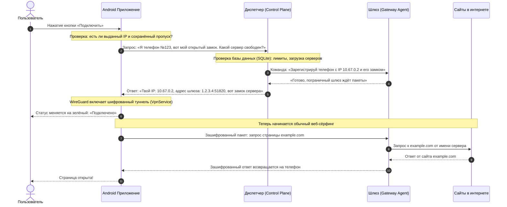

# Как устроен TunnelPilot: простое объяснение исходного кода

> **Для кого этот документ:** для любого человека, который хочет понять, как работает этот VPN. Вам **не нужно** уметь программировать или знать языки Kotlin и Python. Все сложные термины объясняются на понятных жизненных примерах и аналогиях.

---

## Содержание

1. [Что такое VPN простыми словами](#1-что-такое-vpn-простыми-словами)
2. [Главная идея и отличие TunnelPilot](#2-главная-идея-и-отличие-tunnelpilot)
3. [Три главных героя: архитектура системы](#3-три-главных-героя-архитектура-системы)
4. [Магия криптографии: замки и ключи](#4-магия-криптографии-замки-и-ключи)
5. [Пошаговый сценарий: что происходит при нажатии кнопки «Подключить»](#5-пошаговый-сценарий-что-происходит-при-нажатии-кнопки-подключить)
6. [Путеводитель по файлам и папкам проекта](#6-путеводитель-по-файлам-и-папкам-проекта)
7. [Умные функции TunnelPilot](#7-умные-функции-tunnelpilot)
8. [Словарь простых терминов](#8-словарь-простых-терминов)

---

## 1. Что такое VPN простыми словами

Представьте, что обычный интернет — это открытая городская почта:
- Вы отправляете открытку другу.
- Почтальон, сортировщик, соседи и любой прохожий видят, кому вы пишете, что на открытке написано и откуда вы её отправили.
- В интернете этот «почтальон» — ваш интернет-провайдер или владелец кафе с публичным Wi-Fi. Он видит все сайты, на которые вы заходите.

**VPN (Virtual Private Network, виртуальная частная сеть)** — это бронированная труба или непрозрачный запечатанный конверт:
1. Ваш телефон запечатывает сообщение в прочный шифр, который невозможно вскрыть.
2. Сообщение летит через интернет до вашего доверенного сервера.
3. Провайдер видит только одно: «телефон отправил бессмысленный зашифрованный шум на сервер VPN». Он не знает, какой сайт вы открыли (YouTube, Википедию или Telegram).
4. Сервер VPN аккуратно распаковывает сообщение, забирает нужную интернет-страницу и запечатывает её обратно в шифр, отправляя вашему телефону.

---

## 2. Главная идея и отличие TunnelPilot

Большинство коммерческих VPN в магазинах приложений устроены как «чёрный ящик»: вы не знаете, куда уходят ваши пароли, не продаёт ли компания ваши данные рекламодателям и нет ли в приложении скрытых закладок.

**TunnelPilot** построен на трёх железных принципах:
1. **Полная прозрачность:** весь исходный код открыт и лежит перед вами.
2. **Приватные ключи не покидают телефон:** секретный ключ генерируется в аппаратном чипе вашего смартфона и никогда, ни при каких условиях, не отсылается на сервер.
3. **Разделение задач:** сервер управления знает только учётные записи, а шлюз — только шифрованный трафик WireGuard.

---

## 3. Три главных героя: архитектура системы

Система TunnelPilot состоит из трёх независимых частей, которые слаженно работают как единая команда:

```
+-----------------------------+
|   Смартфон (Android App)    |  <-- Ваш карманный пульт и шифратор
+--------------+--------------+
               |
               | 1. "Выдай мне настройки и зарегистрируй мой открытый замок"
               v
+-----------------------------+
|   Диспетчер (Control Plane) |  <-- Электронный ресепшн отеля (FastAPI / SQLite)
+--------------+--------------+      (Сам интернет-трафик через него НЕ ТЕЧЁТ!)
               |
               | 2. "Добавь этот телефон в список гостей"
               v
+-----------------------------+
|    Шлюз (Gateway Agent)     |  <-- Пограничник с турникетом (Linux WireGuard)
+--------------+--------------+
               ^
               | 3. Прямой бронированный туннель для сайтов и видео
               +--------------------------------------------------- (Интернет)
```

### 1. Смартфон (Android Client)
Это само приложение на телефоне. Его задача — показать вам красивый экран с кнопкой «Подключить», запомнить ваши любимые настройки и с помощью встроенного быстрого движка **WireGuard** шифровать каждый интернет-пакет, вылетающий из приложений.

### 2. Диспетчер (Control Plane — Сервер управления)
Это серверная программа на языке Python (библиотека FastAPI). Представьте её как **электронную стойку регистрации в отеле**:
- Она **не** пересылает ваше видео с YouTube и **не** качает файлы.
- Она ведёт базу данных (SQLite): сколько у нас серверов, какие из них работают быстро, сколько свободных мест осталось.
- Когда телефон впервые запускается, Диспетчер проверяет права, выделяет телефону личный IP-адрес внутри туннеля (например, `10.67.0.2`) и выдаёт секретный цифровой пропуск (`device_token`).

### 3. Шлюз (Gateway Agent — Сервер передачи данных)
Это Linux-сервер, который физически подключён к интернету. На нём работает сетевой модуль **WireGuard** (интерфейс `tunnelpilot0`):
- Это суровый пограничник: он слушает команды Диспетчера. Когда Диспетчер говорит «пропусти телефон с таким-то публичным замком», Шлюз открывает для него порт.
- Именно через Шлюз все ваши зашифрованные пакеты выходят в мировой интернет.

---

## 4. Магия криптографии: замки и ключи

В основе безопасности TunnelPilot лежит **асимметричное шифрование** (алгоритм Curve25519 в протоколе WireGuard).

Представьте обычный навесной замок:
- **Открытый замок (Публичный ключ, Public Key):** открытый замок с вашим именем. Вы можете сделать 1000 копий такого замка и раздать их кому угодно: друзьям, серверу, незнакомцам. Захлопнуть этот замок на посылке может любой человек.
- **Единственный ключик (Приватный ключ, Private Key):** единственный физический ключ, который подходит к этому замку. Он лежит в кармане только у вас.

### Как это работает в TunnelPilot:
1. При первом включении приложение на телефоне создаёт пару: открытый замок и ключик.
2. Ключик кладётся в защищённое аппаратное хранилище смартфона (**Android Keystore**). Даже если хакер украдёт ваш телефон или взломает операционную систему, достать этот ключ крайне сложно.
3. Телефон отправляет Диспетчеру **только открытый замок**.
4. Сервер запоминает этот замок. Теперь сервер может зашифровать ответ так, что прочесть его сможет только ваш телефон своим ключом.
5. Сервер даёт телефону свой открытый замок. Телефон захлопывает на нём пакеты, и расшифровать их может только сервер.

> 🔒 **Золотое правило TunnelPilot:** ваш секретный ключ **никогда** не передаётся по сети. Сервер даже при всём желании не сможет подсмотреть ваши личные секреты.

---

## 5. Пошаговый сценарий: что происходит при нажатии кнопки «Подключить»

Давайте проследим жизнь одного клика пользователя от экрана телефона до открытия сайта `example.com`:



---

## 6. Путеводитель по файлам и папкам проекта

Если вы откроете проект в редакторе кода, вот что вы увидите:

```text
PilotTunnelVPN/
├── app/                  <-- Приложение для Android (написано на Kotlin)
├── server/               <-- Серверная часть (написана на Python)
├── scripts/              <-- Удобные скрипты для быстрого запуска
└── docs/                 <-- Документация и технические чертежи
```

### 📱 Папка `app/` (Клиент Android)

Здесь находится всё, что попадает в готовый файл `.apk` на вашем телефоне:

* **`MainActivity.kt` (Главный экран):**
  Здесь описан внешний вид приложения (дизайн на современном Jetpack Compose): большая кнопка включения, индикаторы скорости (RX/TX), карточки доступных серверов, чипы выбора стран и список приложений.
* **`TunnelPilotController.kt` (Мозг приложения):**
  Самый ответственный файл клиента. Он управляет состояниями: «Не настроено» → «Регистрация» → «Готово к работе» → «Подключено». Следит за тем, чтобы приложение не зависало при обрыве Wi-Fi и автоматически восстанавливало связь.
* **`AppSettingsStore.kt` (Блокнот памяти):**
  Сохраняет ваши настройки в зашифрованной памяти телефона: какой сервер вы выбрали, включён ли режим разделения приложений и какой адрес у вашего сервера.
* **`provisioning/ControlPlaneClient.kt` (Курьер связи с сервером):**
  Отправляет сетевые запросы к Диспетчеру: передаёт открытый ключ, запрашивает список доступных регионов и серверов, выполняет миграцию с одного сервера на другой.
* **`wireguard/WireGuardConfigFactory.kt` (Конструктор конфигурации):**
  Собирает стандартный текстовый файл настроек WireGuard, понятный сетевому ядру: указывает адреса DNS, выделенный IP-адрес и ключи шифрования.
* **`debug/DebugCliProvider.kt` (Отладочный пульт):**
  Специальный компонент, который позволяет разработчику управлять приложением через USB-кабель из терминала компьютера. **Внимание:** этот файл автоматически вырезается компилятором из релизной версии приложения (`Release Build`), чтобы никто посторонний не мог им воспользоваться.

### 🖥️ Папка `server/` (Серверная часть)

Здесь находится программное обеспечение для серверов:

* **`server/app/main.py` (Главный сервер Диспетчера):**
  Веб-сервер на FastAPI. Содержит правила приёма гостей: регистрация устройств, выдача токенов, проверка прав администратора, список доступных серверов и мониторинг их здоровья.
* **`server/app/storage.py` (Хранитель базы данных):**
  Работает с базой данных SQLite (`tunnelpilot.db`). Следит за тем, чтобы двум разным телефонам случайно не выдали один и тот же IP-адрес, сохраняет историю серверов и аккуратно удаляет отключённые устройства.
* **`server/gateway_agent/app.py` и `wireguard.py` (Агент шлюза):**
  Небольшая программа-пограничник. Она живёт непосредственно рядом с сетевой картой Linux и отдаёт низкоуровневые команды утилите `wg`: добавить пир (клиента), удалить пир, посмотреть объём переданных мегабайт.

### 🛠️ Папка `scripts/` (Скрипты автоматизации)

* **`start-gateway-agent.sh`:** запускает шлюз WireGuard с минимально необходимыми правами безопасности.
* **`start-control-plane.sh`:** запускает сервер Диспетчера, генерирует безопасные токены и подключается к базе данных.
* **`fix-gateway-forwarding.sh`:** настраивает правила маршрутизации в Linux (включает пересылку пакетов и маскарадинг NAT), чтобы через сервер открывались любые сайты.
* **`tp-adb-cli.sh`:** пульт управления телефоном прямо с компьютера через кабель (установка, проверка статуса, подключение одной командой).

---

## 7. Умные функции TunnelPilot

### 1. Раздельное туннелирование (Selected Apps)
Обычно VPN перехватывает вообще весь трафик телефона. Из-за этого банковские приложения или службы доставки могут блокировать вход («Вы зашли из другой страны»).

В TunnelPilot есть режим **Selected Apps**:
- Вы ставите галочки напротив нужных программ (например, YouTube, Twitter, браузер).
- Только их трафик идёт через бронированный туннель.
- Все остальные приложения (банки, такси, государственные сервисы) выходят в интернет напрямую через вашего обычного оператора на максимальной скорости.

### 2. Безопасная ротация ключей (Key Rotation)
Чтобы поддерживать максимальный уровень безопасности, замки рекомендуется периодически менять:
- В TunnelPilot вы можете в любой момент сменить ключ в один клик.
- Телефон генерирует новую пару ключей, сообщает Диспетчеру новый открытый замок и только после подтверждения удаляет старый.
- Если во время замены ключа внезапно пропадёт интернет, телефон не потеряет связь: он сохранит старый ключ и аккуратно повторит попытку позже.

### 3. Автоматическая привязка к серверу (Server Pinning) и миграция
- Когда вы регистрируетесь, система запоминает, на каком именно сервере вам выделили место.
- Если у вас несколько серверов в разных странах (например, Нидерланды, Германия, Финляндия), вы можете легко переключиться на другой сервер («Мигрировать»).
- При миграции Диспетчер сначала освобождает место на старом сервере, затем бронирует слот на новом и мгновенно перенастраивает туннель без необходимости переустанавливать приложение.

### 4. Автоматическая сверка (Reconciliation)
Что будет, если сервер внезапно перезагрузится от сбоя электричества?
- Диспетчер и Шлюз умеют сравнивать записи в базе данных со списком реально подключённых клиентов WireGuard.
- Если в базе клиент есть, а на сетевом шлюзе его нет — шлюз тихо восстановит запись без обрыва связи для пользователя.

---

## 8. Словарь простых терминов

| Термин | Что это означает на человеческом языке |
|---|---|
| **WireGuard** | Самый современный, быстрый и лёгкий протокол шифрования интернет-связи в мире. Занимает всего несколько тысяч строк кода, благодаря чему работает в разы быстрее старых протоколов OpenVPN и IPsec. |
| **Control Plane** | Диспетчерская служба. Управляет пользователями, правами и базами данных, но не качает пользовательский интернет-трафик. |
| **Gateway (Шлюз)** | Сервер-посредник, через который зашифрованные пакеты выходят в открытый интернет. |
| **Peer (Пир)** | Участник защищённой сети (в нашем случае — ваш смартфон или сервер шлюза). |
| **SQLite** | Сверхнадёжная и компактная база данных, хранящаяся в одном файле на диске. |
| **APK / AAB** | Форматы установочных пакетов для Android: APK устанавливается на телефон напрямую, AAB загружается разработчиками в Google Play. |
| **Keystore** | Аппаратный защищённый сейф внутри процессора смартфона для безопасного хранения секретных ключей. |
